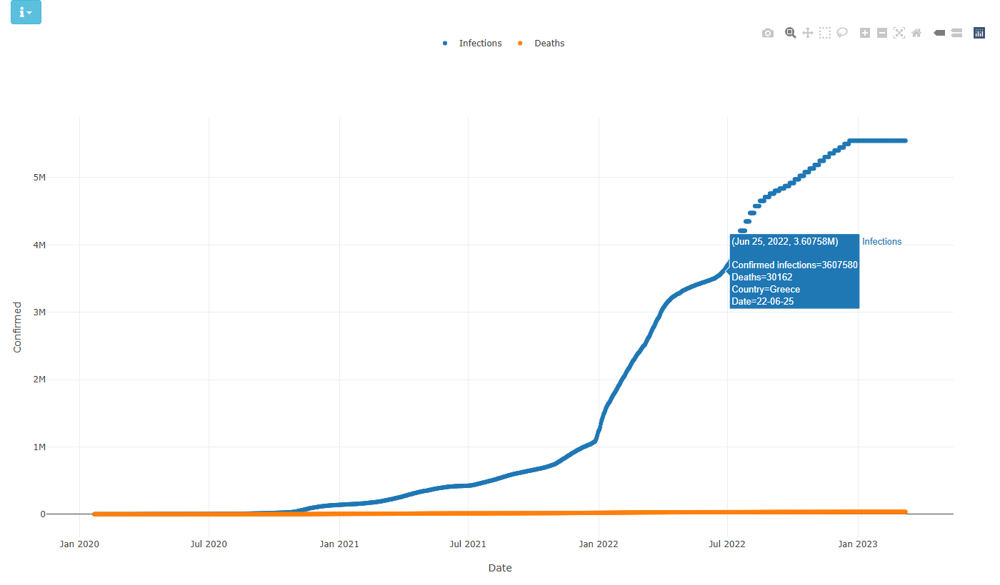

# Time Series covid-19

**[Open the live app](https://sedzinfo.shinyapps.io/covid_timeseries/)** · [Help pages](https://sedzinfo.github.io/covid/reference/)

## What it does

**covid** is a small [Shiny](https://shiny.posit.co/) app, in an R package, that plots the
COVID-19 time series of a country: the running totals of confirmed infections and of deaths,
day by day, in an interactive [plotly](https://plotly.com/r/) chart. Choose the country with
the button at the top left, and hover over a point to see its numbers.

The data are the global time series of the
[COVID-19 Data Repository](https://github.com/CSSEGISandData/COVID-19) of the Center for
Systems Science and Engineering (CSSE) at Johns Hopkins University, read when the app
starts. The repository stopped updating in March 2023.

## Installation

### 1. Install R

Download R from [CRAN](https://cran.r-project.org/), for Windows, macOS or Linux, and run the installer.

### 2. Install RStudio or Positron

An editor makes R easier to use. It is optional, and both are free, from Posit:

- [RStudio Desktop](https://posit.co/download/rstudio-desktop/)
- [Positron](https://positron.posit.co/download.html), which also runs Python

### 3. Install covid

Run one of these in RStudio, Positron or the R console. Each one also installs the packages covid needs.

#### From R-universe (recommended)

```r
install.packages(
  "covid",
  repos = c("https://sedzinfo.r-universe.dev", "https://cloud.r-project.org")
)
```

[R-universe](https://sedzinfo.r-universe.dev/covid) builds covid from this repository after every change, ready to install on Windows, macOS and Linux, and CRAN provides the packages it needs.

#### From GitHub

```r
install.packages("pak")   # once
pak::pak("sedzinfo/covid")
```

#### From the release tarball

The [latest release](https://github.com/sedzinfo/covid/releases/tag/latest) has the source tarball and the PDF manual, rebuilt from `main` on every change:

```r
install.packages("pak")   # once
pak::pak("url::https://github.com/sedzinfo/covid/releases/download/latest/covid_0.0.0.9000.tar.gz")
```

#### From a clone of the repository

This repository keeps no files in [Git LFS](https://git-lfs.com), so a plain clone with [Git](https://git-scm.com/downloads) has everything:

```bash
git clone https://github.com/sedzinfo/covid.git
```

```r
install.packages("pak")   # once
pak::local_install("path/to/covid")
```

## Usage

```r
library(covid)
covid()
```

## Screenshots



---

[](https://sedzinfo.r-universe.dev/covid)


